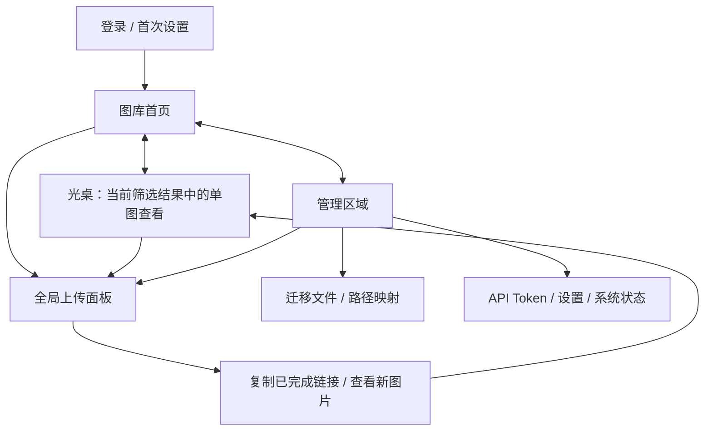

# B 方向：完整产品结构提案

本稿补充 B 光桌概念。原稿主要表达单图查看，尚不足以代表完整产品。本提案将默认入口改为图库总览，光桌作为图库的查看模式；这是待讨论的设计，尚未修改正式路由或页面。

## 全局层

- 顶部只保留图库、管理两个主区域，上传始终可用；主题、语言与账户仍然可达。
- 图库与光桌共享搜索、筛选、排序、当前图片及返回位置。搜索不是新的独立页面，而是图库的结果状态。
- 光桌沿用 B 的单图舞台、底部胶片带和稳定的复制位置；从总览进入时聚焦所选图，退出时返回原图位置。
- 上传在桌面右侧打开，手机独立全屏呈现；收起保留队列，页面刷新后的队列恢复不在本提案承诺内。
- 所有既有页面保留直接地址，图片深链和浏览器返回需正常工作；没有来源上下文的图片深链提供明确的返回图库入口。

## 图库与光桌

- 首页负责浏览、搜索、筛选、排序与批量操作。空图库突出上传，空搜索结果提供清除条件入口。
- 总览选中模式显示批量复制、可见性、转换、删除等既有操作；离开选择模式清楚恢复浏览。
- 光桌承载预览、链接格式切换与复制、元数据、私密状态、历史路径及其他既有操作。
- 胶片带的序列来自当前结果集，不暗示所有图片一次性加载；分页与加载中状态在深化阶段设计。
- 手机总览为双列，光桌为单图和横向胶片带。操作触控区域应至少 44px。

## 管理区域

- 管理的局部侧栏依次为迁移文件、路径映射、API Token、设置、系统状态；底部仅收起导航。
- 表格用于密集数据，分组表单用于配置，运行状态按实际内容展示；不以统一卡片外壳强行套所有页面。
- 手机通过栏目选择器切换，配置纵向排列。涉及修改时保留保存状态及必要的未保存提示。
- 现有配置已从源码核对：默认可见性、转换开关、WebP 质量均存在。截图仅展示部分示例；不表示其他配置删除。
- 默认可见性当前为即时保存；草图中的统一保存是提案，正式深化时需明确一致的保存语义。

## 动效如何贯穿

1. 总览到光桌：所选图保持身份，背景淡退，固定操作随后出现；返回沿同一路径，恢复滚动。
2. 光桌切图：主图短距离横向过渡，胶片带跟随；提前准备邻图，加载尺寸固定，复制位置不动。
3. 上传：面板从固定方向进入；队列行内更新，不反复重排。收起后进度缩回全局入口。
4. 管理：局部导航稳定，内容短过渡；表格和表单不逐项飞入。
5. 所有过渡可被下一次输入打断；减少动态效果设置下直接切换。正式实现需要实测，静态草图不能证明流畅度。

## 本轮产物与边界

- `b-home.html`：图库首页、手机首页、整体结构关系。
- `b-upload.html`：桌面上传面板与手机上传层。
- `b-manage.html`：管理区布局，以设置为例。
- 上轮 `b.html`：光桌查看模式。
- 只有页面级示意链接可跳转，表单、上传、搜索、队列和手机图都是静态示例。没有 API 调用或真实数据操作。
- 本轮没有修改生产源码；正式动效、列表行为、功能迁移和完整状态覆盖仍需下一阶段实施。
